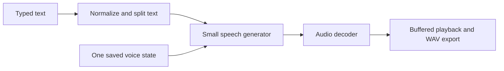

# Oddmouth: a small, offline deep narrator voice

Research and implementation plan — 21 November 2026

Current direction after listening feedback: the user wants expressive conversational YouTube presentation, not neutral audiobook delivery. Hi-Fi TTS speaker 9017 was rejected for performance style. See `DATA_SOURCE.md` for the revised source search; no replacement is approved and no voice dataset has been downloaded.

Explicit `[happy]` and `[angry]` controls are also required. The emotion conditioning, data coverage, and evaluation plan in `EXPRESSION_CONTROLS.md` supersede the earlier suggestion to begin with only narration/conversation style labels.

## Recommendation

Build an English, single-voice TTS product by adapting an existing small speech model. Start with Pocket TTS's 18.2M English variant and KittenTTS Micro 0.8 (40M), compare their voices and browser behavior, then select the training route. Keep Kokoro-82M as a larger quality reference. Use a trainable Matcha-TTS pipeline as the fallback if the small pretrained models cannot be adapted satisfactorily.

The goal is credible: attractive deep speech, local generation, no character quota, and a deployed neural pipeline below about 50M parameters. **Matching ElevenLabs on expression, unfamiliar text, and conversation at that size is an experimental goal, not an established result.** We should establish how close we can get before committing to a major training run.

This is a research plan, not a trained model or a listening benchmark. No audio has been generated or auditioned in this research session. Model speeds and quality claims below are attributed to their authors; project targets and resource estimates are proposals.

Working assumptions: English first; one original warm, resonant, older-sounding male voice; narration and spoken replies; static website delivery; no inference server. Other languages and a complete voice assistant are separate scope.

## The basics

A TTS model learns a relationship between written words and recorded speech. Training needs audio **and the exact corresponding text**. It learns pronunciation, timing, pitch movement, and the sound of a speaker.

Think of the process as three jobs:

1. **Read the text correctly.** Turn “Dr. Rao paid $12.50” into the intended spoken words and pronunciation. A phoneme is a speech sound; a phonemizer converts spelling into those sounds.
2. **Perform it.** Decide emphasis, pauses, melody, energy, and speed. These choices are called prosody. They make the difference between reading words and telling a story.
3. **Produce sound.** A vocoder or audio decoder converts the model's compressed sound representation into a waveform that speakers can play.

Different architectures combine these jobs differently. A spectrogram model predicts a time-frequency picture of speech and a vocoder renders it. A codec model predicts compressed speech representations and a decoder renders them. Both can generate new speech rather than stitch together prerecorded words.

“50M parameters” means about fifty million learned numbers. It does not mean a 50 MB download, a 50 MB memory footprint, or a particular speed. Keeping only one voice removes unnecessary flexibility, but removing a speaker embedding from a multi-voice model rarely removes most of its parameters. The shared speech generator is still required.

Fine-tuning is adapting a model that already speaks. Distillation teaches a smaller model to reproduce useful behavior from a larger teacher. Quantization stores its numbers with fewer bits. These solve different problems: quantization shrinks storage without reducing parameter count; a genuinely smaller architecture reduces parameter count.

## What the voice target means

The likely reference is **Grandpa Spuds Oxley**, identified in ElevenLabs' own voice library. Use its broad characteristics—warmth, older character, resonance, storytelling cadence—as the brief. An exact replica requires an authorized source and an appropriate training grant; access to a voice on a platform is not itself a grant to train a replacement model. [ElevenLabs voice library](https://elevenlabs.io/voice-library/grandpa)

Suggested original voice brief: mature male baritone; warm chest resonance; slight natural rasp; clear consonants; relaxed storytelling pace; friendly short conversational responses. Avoid making pitch the sole objective. A low-pitched voice can still sound thin or robotic; convincing depth depends on resonance, articulation, timbre, and performance together.

Select one speaker whose real recordings already approach this brief. Do not combine unrelated low-pitched speakers and expect a consistent identity. Pitch shifting is useful as a listening experiment, but cannot substitute for suitable training speech.

## Current models and what the research changes

| Candidate | Verified size or release detail | Role in this project | Main uncertainty |
|---|---|---|---|
| Pocket TTS small English | Official configuration describes 15.6M flow LM + 2.6M decoder = 18.2M | First candidate for expressive, streaming speech with size headroom | Export and adaptation of this exact small variant need validation |
| KittenTTS Micro 0.8 | Model card: 40M, roughly 40 MB, eight voices, 24 kHz | Direct small ONNX baseline, especially male presets | A supported end-to-end custom training recipe was not established here |
| KittenTTS 2 Nano | Model card: 17M per language; English ONNX about 17.4 MB INT8 / 8.83 MB INT4 | New compact competitor worth an immediate listening test | Newly published package; verify voice controls and training path separately |
| Kokoro-82M | 82M, Apache-licensed weights | Larger compact quality reference | Exceeds strict 50M even when quantized |
| Matcha-TTS + paper vocoder | Paper: 18.2M acoustic model + 13.9M vocoder = 32.1M | Trainable fallback with a clear size budget | Original research evaluation is single-speaker read speech, not our target voice |
| M5-TTS | 50M **excluding codec** | Recent architecture reference and optional comparison | Not established as a complete sub-50M pipeline; training code not released |
| Qwen3-TTS | Released 0.6B and 1.7B variants | Larger teacher/reference candidate | Much too large for the proposed deployed model |

Sources: [Pocket small configuration](https://github.com/kyutai-labs/pocket-tts/blob/main/pocket_tts/config/english_18m_2026-10.yaml), [Kitten Micro model card](https://huggingface.co/KittenML/kitten-tts-micro-0.8), [Kitten Nano card](https://huggingface.co/KittenML/kitten-tts-2-nano), [Nano files](https://huggingface.co/KittenML/kitten-tts-2-nano/tree/main), [Kokoro card](https://huggingface.co/hexgrad/Kokoro-82M), [Matcha paper, Table 1](https://arxiv.org/html/2309.03199v2), [M5 repository](https://github.com/ASLP-lab/M5-TTS), [Qwen repository](https://github.com/QwenLM/Qwen3-TTS).

### Paper findings translated into decisions

**StyleTTS 2 (2023): performance matters beyond waveform reconstruction.** It models speaking style with diffusion and uses a pretrained speech model as a training discriminator. A large training-only critic need not ship to users. Useful lesson: spend training effort on natural delivery, while measuring deployment size separately. Its human-level claims belong to its particular datasets and listening tests, not an unconditional quality guarantee. [Paper](https://papers.neurips.cc/paper_files/paper/2023/file/3eaad2a0b62b5ed7a2e66c2188bb1449-Paper-Conference.pdf)

**Matcha-TTS (2023 / ICASSP 2024): a small flow model is a practical trainable baseline.** It predicts durations, expands text features, and uses conditional flow matching to generate acoustic frames in a few solver steps. More steps trade speed for quality. Its reported GPU real-time factors do not establish browser speed. The paper explicitly cautions against comparing mean opinion scores across unrelated studies. [Paper](https://arxiv.org/html/2309.03199v2)

**F5-TTS (2024): flexible alignment and flow matching can support natural speech.** Its text-conditioned speech-infilling system uses a diffusion transformer and Sway Sampling. This is useful research, but an architecture paper is not a browser deployment recipe. The official pretrained weights are CC-BY-NC, whereas code is MIT; exclude those weights from the default unrestricted commercial route. [Paper](https://arxiv.org/html/2410.06885v3), [official licensing](https://github.com/SWivid/F5-TTS#license)

**Continuous Audio Language Models (2025, ICLR 2026): predict compact continuous audio efficiently.** CALM combines a causal backbone with a small consistency-based sampling head, avoiding a long series of discrete codebook predictions. This motivates Pocket TTS for streaming. We should preserve useful state across audio chunks and evaluate small variants rather than assuming a billion-parameter language model is necessary. [Paper](https://arxiv.org/html/2509.06926v2)

**Qwen3-TTS (January 2026): streaming is a system property.** It uses low-frame-rate audio representations, multi-token prediction, and causal decoding; its reported first-packet latency is measured in its own hardware setup. It is a possible offline teacher or quality reference, not the browser student. Reported training scale exceeds five million hours: reproducing a frontier foundation model from zero is a different project from adapting one voice. [Technical report](https://arxiv.org/html/2601.15621v1)

**M5-TTS (October 2026): small headline counts need scrutiny.** Its temporal backbone and within-frame predictor total 50M, with a separate codec. The reported 225 ms warm first chunk and 0.653 real-time factor are on four Xeon CPU cores. Its GRPO refinement combines speaker, pause, and text-error feedback. Useful ideas, but browser performance and total size remain separate questions. [Report](https://aslp-lab.github.io/M5-TTS-Demo-Page/m5-tts-v3.pdf)

The latest release evidence matters: Pocket now supplies much smaller English configurations, and its public training documentation includes teacher fine-tuning and depth distillation. This makes an adaptation experiment more attractive than immediately inventing a new architecture. It does **not** prove that the supplied six-layer distillation recipe produces the separate 18.2M architecture without additional work. [Pocket releases/configurations](https://github.com/kyutai-labs/pocket-tts), [training documentation](https://github.com/kyutai-labs/pocket-tts/blob/main/training/README.md)

## Free training data

| Dataset | Published characteristics | Use for us |
|---|---|---|
| Hi-Fi TTS / OpenSLR 109 | 291.6 hours, 10 speakers, at least 17 hours each, 44.1 kHz; CC BY 4.0; 41 GB archive | First manageable place to audition male narrators and choose one consistent speaker |
| HiFiTTS-2 | Metadata for about 36,700 hours / 5,000 speakers; CC BY 4.0; audio fetched separately from LibriVox | Broader speaker search and optional pretraining subset; do not download the full corpus first |
| LibriTTS-R / OpenSLR 141 | Restored version of approximately 585 hours at 24 kHz; CC BY 4.0 | Extra English coverage and candidate speakers; audit restoration artifacts |
| LibriTTS / OpenSLR 60 | Approximately 585 hours, 24 kHz; CC BY 4.0 | Original counterpart for comparing restoration and checking source speech |
| VCTK 0.92 | 110 speakers, roughly 400 sentences each; controlled recording setup | Accent/robustness resource, less speech per speaker; inspect exact downloaded license before adoption |
| LJSpeech | About 24 hours, one female speaker; public domain in the US | Pipeline sanity check only; does not match the desired male voice |

Direct sources: [Hi-Fi TTS](https://openslr.org/109), [HiFiTTS-2](https://huggingface.co/datasets/nvidia/hifitts-2), [LibriTTS-R](https://openslr.org/141/), [LibriTTS](https://www.openslr.org/60/), [VCTK](https://datashare.ed.ac.uk/handle/10283/3443), [LJSpeech](https://keithito.com/LJ-Speech-Dataset/).

HiFiTTS-2 is particularly useful because its manifest exposes speaker IDs, transcripts, duration, estimated bandwidth, speaker count, and text-error estimates. Rank speakers by usable hours, sample a few minutes across chapters, and download only a shortlist. Its card estimates multi-terabyte storage for complete downloads; its published sampling rate does not guarantee every source has equivalent acoustic bandwidth. [Dataset card and download instructions](https://huggingface.co/datasets/nvidia/hifitts-2)

### Speaker selection and preparation

1. Audition 10–20 male candidates across at least three chapters/sessions. Rank depth, warmth, accent, expression, consistency, noise, and usable hours. A low estimated fundamental frequency can help shortlist; listening makes the decision.
2. Aim initially for **10–30 clean hours from one speaker** for adaptation experiments. This is our planning target, not a universal minimum or a guarantee. Smaller datasets may work with pretrained models; demanding new training may need more.
3. Keep original audio and provenance. Prepare 24 kHz mono copies for a 24 kHz model. Upsampling does not restore lost detail.
4. Segment at sensible sentence/clause boundaries, initially around 2–15 seconds as the selected trainer permits. Preserve beginnings, final consonants, and natural pauses. Reject music, overlap, severe reverb, clipping, and inconsistent character voices.
5. Verify exact transcripts using ASR disagreement plus manual review. Keep both written and normalized text. Use forced alignment where the chosen training recipe requires it.
6. Split by chapter/session or book, not adjacent random clips. Hold out roughly 5–10% each for validation and test when the corpus supports meaningful separation. Deduplicate across splits and prevent teacher augmentation from reintroducing held-out texts.
7. Maintain source URL, speaker, chapter, license, required attribution, processing history, and file hash in every training manifest.

Audiobooks favor read-aloud delivery. We can begin a narration product with them, but need questions, acknowledgments, reassurance, excitement, and short casual replies to establish conversational quality. If free data cannot provide that range in the chosen voice, the strongest upgrade is a consenting performer recording additional material in both delivery styles. This is optional expense for better quality, not a prerequisite to the free-data experiment.

CC BY allows reuse with conditions including attribution. It does not automatically clear publicity, privacy, or other rights; the license itself identifies that limitation. Keep data/model grants separate from a person's voice permissions and platform output terms. [CC BY 4.0 explanation](https://creativecommons.org/licenses/by/4.0/)

## Architecture and training approach

All boxes above can run on the user's device. Training, data preparation, evaluation, and any teacher model run offline on development hardware.

### Route A: adapt an existing small model

First test Pocket 18.2M with a fixed voice state and Kitten Micro with its male presets. Also test Kitten 2 Nano because its storage is attractive. If an acceptable preset already exists, a useful unlimited narration tool may require no training.

For a custom voice, prove trainability before choosing the base: load an actual trainable checkpoint, adapt on a tiny approved subset, export, and verify the output matches native inference. Having an ONNX inference file or a float checkpoint does not by itself establish a reproducible fine-tuning workflow.

For Pocket, start from its documented teacher fine-tuning workflow if direct small-variant fine-tuning is not supported. Adapt the teacher to the selected speaker; then reproduce a documented student pipeline. Separately determine whether the 18.2M variant can be adapted directly or needs additional distillation code. Keep this as an explicit experiment, not a promised turnkey step.

Train a stable neutral voice first. Then add two coarse delivery conditions—narration and conversation—only if the model and data can support them. Freeze or cautiously fine-tune the decoder initially; compare results. Generate held-out examples at each checkpoint and retain a real-audio-only baseline.

Optional teacher-generated expansion can cover pronunciation and delivery gaps. Use only an appropriately licensed teacher and authorized voice. Human-check a sample, filter transcription errors and speaker drift, and compare real-only against mixed training. Synthetic volume cannot recover missing authentic performance, and teacher errors can become student habits. Keep a large teacher out of the final browser bundle.

### Route B: train a compact Matcha-style system

Use the published implementation and training pipeline if Route A cannot meet custom-voice requirements. The paper's approximately 32.1M acoustic-plus-vocoder configuration demonstrates a plausible size envelope. Start with a suitably licensed pretrained vocoder, prove reconstruction on the actual chosen speaker, then train/adapt the acoustic model.

An experimental expanded budget could allocate 6M to text features, 3M to timing/prosody, 22M to a flow decoder, 14M to a vocoder, and 3M to other learned projections/controls: **48M total**. This is a design budget, not an implemented architecture or a measured checkpoint. Do not count the acoustic decoder twice or exclude a separately downloaded learned text frontend.

Evaluate 2, 4, and 8 flow steps. If extra steps noticeably improve delivery but break realtime targets, investigate distillation only after the quality improvement is demonstrated. Size, naturalness, and first-audio latency must be measured together.

## Browser deployment

Use a Web Worker for normalization and synthesis; send audio chunks to an AudioWorklet or scheduled Web Audio playback. Package versioned model files, vocabulary/phonemizer assets, fixed voice state, runtime, and attribution. Cache them for subsequent sessions and offline use. Model files remain downloadable by website users; frontend delivery cannot keep the weights secret.

Try ONNX Runtime Web with WebAssembly first for broad reach, then WebGPU on measured supported devices. Official ONNX documentation distinguishes the broader WASM operator coverage from subsets supported on accelerated backends. A desktop ONNX export is therefore a starting point, not proof of browser compatibility. Quantized operators, dynamic shapes, and state caches require particular attention. [ONNX Runtime Web](https://onnxruntime.ai/docs/tutorials/web/), [WebGPU guidance](https://onnxruntime.ai/docs/tutorials/web/ep-webgpu.html)

Benchmark the exact release in Chrome/Edge desktop, Safari on macOS/iPhone, and Chrome Android; add Firefox if required. Feature-detect acceleration and keep a tested WASM path. Threaded WASM may require cross-origin isolation; verify hosting headers, runtime version, and embedded-site constraints. Runtime compatibility tables can lag browser releases, so do not promise a device from a browser name alone.

For autoregressive streaming, retain bounded model and decoder state. For a sentence-based noncausal model, call it sentence playback rather than claiming true streaming. Avoid indefinitely growing attention caches; verify long-text behavior across bounded chunks. Split around clauses and sentence boundaries and preserve context where supported. Test joins on plosives and pauses; indiscriminate crossfades can blur consonants.

Use a small initial audio buffer for responsiveness and more lookahead for sustained playback. Support cancel, regenerate one sentence, speed control, and stable per-chunk seeds where supported. Save long recordings incrementally instead of retaining all PCM in RAM. At 24 kHz mono PCM16, an hour is about 173 MB in decimal units; Float32 buffers double that. WAV is the first export target; compressed formats can follow with a tested local encoder.

### Size and memory accounting

| Learned weights | FP32 | FP16 | INT8 | Ideal packed INT4 |
|---|---:|---:|---:|---:|
| 50M parameters | 200 MB | 100 MB | 50 MB | 25 MB |

These are arithmetic storage estimates, excluding quantization scales, graph metadata, runtime, voice data, and text assets. A quantized file can still compute partly in Float32 or expand weights at runtime. Peak RAM includes activations, caches, compilation, model copies, and audio buffers. Measure it directly. Start with FP32 reference output, compare FP16/INT8, and attempt INT4 only when audible quality and actual runtime support justify it.

If a frontend uses eSpeak NG for phonemization, its GPL licensing needs to be included in the distribution decision; the neural weights' Apache license does not settle the whole application's dependency licensing. A model-compatible, appropriately licensed frontend is an alternative. [eSpeak NG license](https://github.com/espeak-ng/espeak-ng/blob/master/COPYING)

“Unlimited” means no vendor character quota or per-recording inference bill. It still uses the listener's CPU/GPU, electricity, storage, and time. The site and first model download need delivery; after caching, synthesis can work offline. Training is a separate upfront compute cost. TTS speaks supplied text; microphone understanding and composing conversational replies require ASR and a dialogue model separately.

## Evaluation and definition of success

Use the same held-out texts for every candidate, loudness-match listening samples, and randomize playback order. Compare to a natural recording, the best small baseline, Kokoro, and an authorized ElevenLabs reference if one is available. Separate *voice-character match*, *naturalness*, *intelligibility*, and *expression* ratings. A narrator can excel at one and fail another.

Proposed engineering gates, to be revised after measuring real target devices:

| Dimension | Initial acceptance target |
|---|---|
| Total deployed neural parameters | At most 50M, including decoder and any learned text model |
| Text accuracy | At most 2% normalized ASR WER on a clean English test set; manually inspect names/numbers and apparent ASR errors |
| Severe failures | Zero skipped/repeated sentences or runaway generation on 200 held-out prompts and a 30-minute narration test |
| Naturalness | Mean human rating at least 4/5 in our own test, with uncertainty reported; no cross-paper MOS equivalence claim |
| Character | User-approved deep male identity across both long narration and short replies |
| Preference | Aim for at least 70% preference over our initial small baseline; report listener count and confidence interval |
| Sustained speed | RTF at most 0.7 on target laptops and at most 1.0 on explicitly supported phones |
| Warm first audible output | Aim under 500 ms laptop / 1 second phone, including text work and buffering, reported as median and p95 |
| Long use | Thirty-minute playback/export without memory growth, lost text, crashes, or sustained buffer underruns |
| Offline operation | After caching, network disabled; generating and exporting still work; no text/audio inference requests |

RTF means generation seconds divided by audio seconds: 0.5 means ten seconds of speech takes five seconds to generate. Measure cold download, model initialization, warm first chunk, and sustained throughput separately. Record device, browser, threads, backend, precision, peak memory, thermal slowdown, and battery behavior. Automated quality estimators help catch regressions but cannot replace listening, especially for deliberate rasp or an older voice.

Use `VOICE_EVALUATION_PROMPTS.tsv` as a seed set; expand to 200 prompts before selecting a release. Include dates, money, abbreviations, heteronyms, Indian and other proper names, questions, whispers if supported, short acknowledgments, long sentences, and paragraph joins. Test ordinary expressive speech first; laughter, crying, singing, and simultaneous speech are additional capabilities.

## Work plan and resource envelope

These are engineering estimates for one experienced ML engineer with frontend support, not vendor quotes or measured training durations. Custom architecture work can extend the schedule materially.

| Stage | Approximate time | Deliverable and decision |
|---|---|---|
| 1. Feasibility | 3–5 days | Same-text small-model audio, exact asset/parameter inventory, one native-to-browser comparison; choose candidate or fallback |
| 2. Voice/data selection | 3–7 days | Audition shortlist, chosen speaker, usable-hour report, source/license manifest, chapter-separated splits |
| 3. Adaptation pilot | 1–2 weeks | Trainable checkpoint, held-out samples, reproducible export; stop if voice or alignment is wrong |
| 4. Quality improvement | 1–3 weeks | Best real-data model; controlled tests of style data, teacher assistance, decoder tuning, and compression |
| 5. Browser integration | 1–2 weeks, partly overlapping | Offline synthesis, cancellation, playback, export, device measurements |
| 6. Release evaluation | About 1 week | Listening results, long-form soak, artifact checksums, model card, attribution and reproducibility notes |

Plan roughly **6–10 weeks for a serious custom-voice prototype**, with a usable preset-based proof potentially much earlier. No schedule guarantees quality parity.

Begin with a single NVIDIA GPU with 16–24 GB VRAM for small adaptation experiments; larger teachers or training configurations may need 48–80 GB or more. Pocket's current training guide gives an example consumer configuration around 16 GB with reduced batches, whereas its default wants about 56 GB. That is evidence for an experiment, not assurance for every candidate. [Training requirements](https://github.com/kyutai-labs/pocket-tts/blob/main/training/README.md)

Reserve 20–100 GPU-hours for the first adaptation/ablation round as a planning allowance, then measure seconds per optimizer step on a small pilot and recalculate. Multiple failed runs or teacher generation can consume more. Compute spend is measured GPU-hours × chosen current hourly rate, plus storage; no live rental price is assumed here. Foundation pretraining from zero is excluded from that allowance. Start with 100–300 GB working storage for curated subsets and checkpoints, expanding only when the data requires it.

## Immediate next experiment

Produce a comparison of Pocket 18.2M, Kitten Micro 40M, Kitten 2 Nano, and Kokoro on the same 40 prompts. Audition available male voices and 10–20 public-data speaker candidates. For the two most promising systems, verify one browser inference/export path and one custom-voice training path. Choose the approach from those results.

If a free-data voice is attractive but insufficiently conversational, ship narration first and add performance data deliberately. If under-50M quality falls short, show the measured difference against 82M before deciding whether the size limit or quality goal should move. Do not claim ElevenLabs parity without a matched listening comparison.
